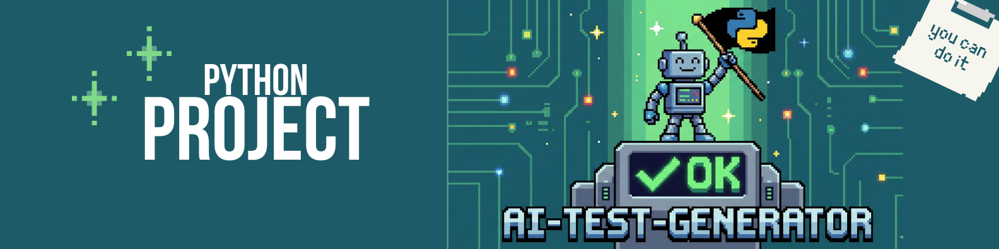

<h1 align="center"> </h1>

    
  
  
  
  

---

<h1 align="center"> 🚀 Sobre </h1>

O **AI-Test-Generator** é uma ferramenta em Python que automatiza a criação de **testes unitários robustos com `pytest`** para funções Python.  
Utilizando a **API da OpenAI**, o projeto gera testes seguindo o padrão **Arrange-Act-Assert (AAA)**, cobrindo:

- ✅ Cenários típicos de sucesso  
- ⚠️ Casos extremos (ex.: listas vazias, números negativos)  
- ❌ Tratamento de exceções (usando `pytest.raises`)  

Ideal para desenvolvedores que querem **aumentar a qualidade do código** sem escrever testes manualmente.

---

## ✨ Funcionalidades

- Geração automática de testes unitários para qualquer função Python.  
- Criação de arquivos de teste na pasta `Test/`.  
- Estrutura AAA rigorosa para clareza e manutenção.  
- Suporte a múltiplos testes por função (definido pelo usuário).  

---

## ⚙️ Instalação

1. Clone o repositório:

        git clone https://github.com/seu-usuario/AI-Test-Generator.git
        cd AI-Test-Generator

2. Crie e ative um ambiente virtual:

        python -m venv venv
        source venv/bin/activate   # Linux/Mac
        venv\Scripts\activate      # Windows

3. Instale as dependências:

        pip install openai pytest

4. Configure sua API Key da OpenAI no arquivo principal main.py:

        Client = OpenAI(api_key="SUA_CHAVE_AQUI")

---

## 🏃 Como usar

Execute o script principal:

    1. python main.py
    2. Cole o código da função que deseja testar.
    3. Defina o número de testes a gerar (máx. 3 recomendado).
    4. O script criará automaticamente os testes na pasta Test/.

---

## 📂 Estrutura do projeto

    AI-Test-Generator/
    │
    ├─ main.py             # Script principal
    ├─ Test/               # Pasta onde os testes são gerados automaticamente
    │   └─ test_function.py
    ├─ README.md
    └─ requirements.txt    # Dependências do projeto

---

## 💡 Exemplo de Teste Gerado

    from main_app import soma
    import pytest
    
    def test_soma_success():
        # Arrange
        a = 5
        b = 3
        expected = 8
        # Act
        result = soma(a, b)
        # Assert
        assert result == expected
    
    def test_soma_negative():
        # Arrange
        a = -5
        b = -10
        expected = -15
        # Act
        result = soma(a, b)
        # Assert
        assert result == expected

---

<h1 align="center">🎬 Demonstração </h1>

<h1 align="center">(Demonstração em Andamento)</h1>

---

## 🤝 Contribuição
Contribuições são bem-vindas! Abra issues ou pull requests para melhorias, bugs ou novas funcionalidades.

---

## 👨‍💻 Autor

 Diogo Teodoro Dias Lamas

 Feito em Python &nbsp;|&nbsp; <b>#SoftwareEngineering</b> 🧠 
 

